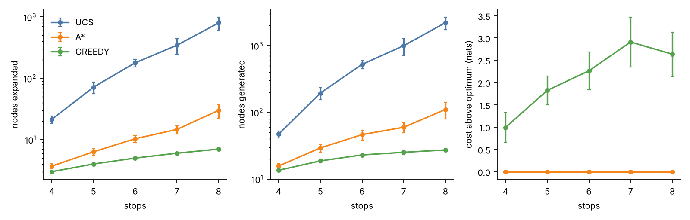
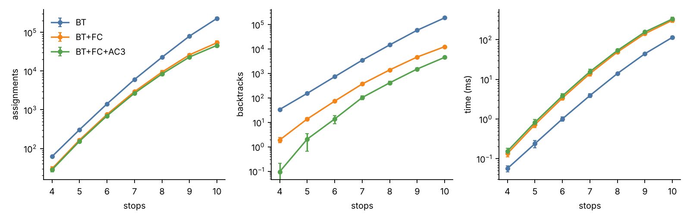
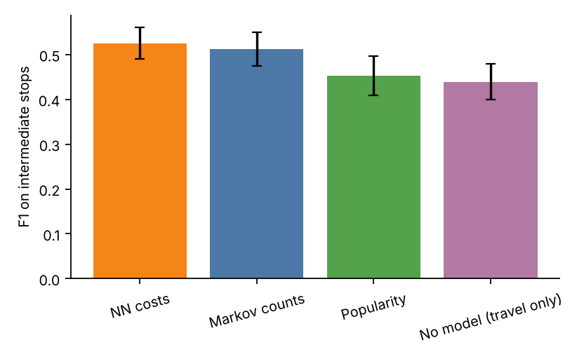

# 1. Problem

A tourist gives a **start place, an end place, a time budget, a must-see category** and a number of stops.
The system must return an itinerary with arrival times and stay durations that (i) obeys simple rules, (ii) fits the
budget and (iii) is *plausible*, i.e. similar to what real travellers do. We combine three techniques:

* a **neural network** that learns from real trajectories which place people visit next and how long they stay;
* a **CSP** that first chooses the *category pattern* of the tour (e.g. Park → Museum → Structure → Cultural → Structure → Park);
* a **search** (UCS, A*, Greedy) that then picks the real places for a pattern, minimising an NN-based cost.

Rules of a valid pattern: neighbouring stops have different categories; the must-see category appears; no category
more than twice; the (lower bound of the) total time is within the budget. The first and last stop are the given places.

# 2. Data

Flickr tour dataset of Lim et al. (CIKM'16), Edinburgh: 28 places, 7 853 visits by 1 454 users, built from geotagged
photos (full column list and real/generated status in `docs/DATA_DICTIONARY.md`). Following the task we keep places
with ≥ 20 visits (28 → 25 places; Structure 10, Historical 4, Park 4, Cultural 3, Museum 3, Entertainment 1), giving
7 828 visits, 1 448 users, 5 009 trajectories and **2 819 consecutive-place transitions**. Users are split 70/15/15 % into
train/validation/test (no user appears in two sets); the seed changes the split.

Three properties of the data matter for everything below. (1) **Durations are noisy:** they are last-photo minus
first-photo time, so 68 % of visits are below 5 minutes (a single photo). We clip to [5 min, 4 h]. (2) **Timestamps are not
local time:** photo activity peaks at stored hour 03–04 in all five cities, so we add 11 h (an assumption; documented).
(3) Walking times (4.5 km/h, ×1.3 detour), budgets, number of stops, start hours and must-see categories in the
experiments are **generated**, not observed.

# 3. Design

## 3.1 Neural networks (`tourplan/nn.py`)

Both heads are small ReLU MLPs written in NumPy with manual back-propagation and Adam (no framework needed).
Input = one-hot place + sin/cos of the hour (24 h and 12 h harmonics).
*Next-place head*: 2×64 hidden units, softmax over places with the current place masked (a tourist never "moves" to the
same place); loss = negative log-likelihood (NLL). *Duration head*: 1×16 hidden units, regression on log seconds (MSE).
Weight decay 0.01 and the architecture were chosen by validation NLL/MSE on seeds 0–2 (grid of 18 and 9 settings);
early stopping on validation. Baselines: count-based first-order **Markov** chain (additive smoothing tuned on validation;
hour-independent), **popularity**, per-place **mean log duration** and the global mean. For the planner the networks are
turned into look-up tables over 48 half-hour buckets: `logp[b][i][j]` and expected stay minutes `dur[b][i]`.

## 3.2 CSP (`tourplan/csp.py`)

Variables $x_0\dots x_{n-1}$ are the categories of the stops; $x_0, x_{n-1}$ are fixed by the start/end place.
Constraints: neighbours differ (binary), must-see present, per-category cap (≤ 2 and ≤ number of places in the category),
and total time ≥ lower bound ≤ budget, where the bound adds, per stop, the shortest predicted stay in the category and,
per link, the shortest walk between categories (so no valid pattern is ever lost; the exact check is made by the search).
Three switchable solvers share the code: **BT** (constraints checked when their variables are assigned),
**BT+FC** (forward checking also for the global rules: saturated categories removed, must-see forced into its only
remaining slot, budget bound) and **BT+FC+AC-3** (AC-3 on the neighbour constraints at the root and re-established after
every assignment). Counters: assignments, backtracks, checks, revisions, prunings. All three return identical solution sets
(asserted in the experiment and in the tests). Value ordering uses the category-transition frequencies of the training data;
the 10 patterns passed on are the 10 most likely under that category chain.

## 3.3 Search (`tourplan/search.py`)

State = (position in the plan, current place, visited set, elapsed minutes); action = go to an unvisited place whose
category is the one the pattern requires next (the last position is forced to the end place). Step cost =
$-\log P_{NN}(j\mid i,\text{hour on leaving } i) + \lambda\cdot\text{walking minutes}$, $\lambda=0.05$ nats/min (not tuned).
Stays are whole minutes, $\max(5,\text{round}(\text{predicted}))$; states exceeding the budget are pruned using an
admissible bound on the remaining minutes. **UCS** orders by $g$, **A\*** by $g+h$, **Greedy** best-first by $h$.
The heuristic $h$ is an exact backward dynamic programme over positions in a relaxed problem (visited set ignored, cheapest
clock hour for every step); it is admissible and consistent, so A* is optimal. Counters: nodes expanded/generated, pruned,
maximum open list. A brute-force enumerator verifies optimality on real-model instances (tests).

## 3.4 Integration (`tourplan/integration.py`)

CSP (without budget) → if empty: **"No solution"** with the reason (unknown must-see, too many stops for the 2-per-category
rule, two stops of the same category…). Otherwise CSP (with budget) → ≤ 10 most likely patterns → search each → patterns
whose predicted stays exceed the budget are rejected → the lowest-cost itinerary is returned. If all 10 are rejected the
planner first computes the **exact smallest feasible budget** (branch and bound over all valid patterns with a time-cost A*);
if that budget is within the request it widens the pattern list, otherwise it returns the **shortest itinerary with a warning**
that states the smallest budget that works. (This widening was added after a test showed that rejecting the top-10 patterns
could wrongly report "over budget".)

{width=100%}

# 4. Results

All numbers are mean ± standard deviation over **10 seeds** (each seed = different user split, NN initialisation and generated requests).

## 4.1 Neural networks vs count-based baselines (test users)

| next place | NLL ↓ | top-1 ↑ | top-3 ↑ |
|---|---|---|---|
| NN (hour-aware) | 2.566 ± 0.052 | 0.235 ± 0.022 | 0.481 ± 0.030 |
| Markov counts | **2.551 ± 0.054** | **0.247 ± 0.021** | **0.504 ± 0.030** |
| Popularity | 2.836 ± 0.037 | 0.139 ± 0.012 | 0.329 ± 0.029 |

| duration (log s) | RMSE ↓ | MAE ↓ | MAE (min) ↓ |
|---|---|---|---|
| NN | **1.214 ± 0.053** | **0.949 ± 0.039** | 27.2 ± 2.9 |
| per-place mean | 1.226 ± 0.055 | 0.959 ± 0.039 | 27.3 ± 3.0 |
| global mean | 1.241 ± 0.059 | 0.983 ± 0.039 | 27.4 ± 3.0 |

**The next-place NN does not beat the Markov counts**: NLL is 0.015 ± 0.027 *worse* (paired over seeds, p = 0.12; better in only 2 of 10 seeds).
Both are far better than popularity, so the current place carries the information; the hour adds little with only about 1 900
training transitions. The duration NN is slightly but consistently better than the per-place mean (RMSE −0.013 ± 0.010, 9/10 seeds, p = 0.003),
yet all errors are large because the targets are noisy (§2). Training curves: `figures/nn_training.png`.

## 4.2 Experiment 1 — UCS vs A* vs Greedy (4–8 stops; 150 requests per size)

| stops | UCS expanded | A\* expanded | Greedy expanded | A\* time (ms) | UCS time (ms) | Greedy cost above optimum | Greedy optimal |
|---|---|---|---|---|---|---|---|
| 4 | 21.3 ± 3.0 | 3.7 ± 0.4 | 3.0 | 0.04 | 0.15 | 0.99 ± 0.33 | 40 % |
| 5 | 71 ± 15 | 6.3 ± 0.7 | 4.0 | 0.08 | 0.49 | 1.82 ± 0.33 | 16 % |
| 6 | 178 ± 26 | 10.3 ± 1.4 | 5.0 | 0.12 | 1.36 | 2.26 ± 0.42 | 9 % |
| 7 | 344 ± 97 | 14.6 ± 2.3 | 6.0 | 0.16 | 2.58 | 2.91 ± 0.56 | 5 % |
| 8 | 796 ± 199 | 29.9 ± 7.5 | 7.0 | 0.31 | 7.29 | 2.64 ± 0.50 | 9 % |

UCS and A* always return the same optimal cost (gap 0 in all 750 requests); A* expands **27× fewer nodes** at 8 stops and the gap
widens with length. Greedy is fastest (it expands one node per position) but returns a more costly path (about 2–3 nats of cost above the optimum, which combines lower NN likelihood and extra walking)
and is optimal in only 5–40 % of cases. {width=100%}

## 4.3 Experiment 2 — BT vs BT+FC vs BT+FC+AC-3 (full enumeration; 250 requests per size)

| stops | variant | assignments | backtracks | time (ms) |
|---|---|---|---|---|
| 6 | BT | 1 423 ± 14 | 739 ± 28 | 1.0 |
| 6 | BT+FC | 759 ± 37 | 74 ± 5 | 3.4 |
| 6 | BT+FC+AC-3 | 699 ± 33 | 14 ± 5 | 3.8 |
| 8 | BT | 22 807 ± 1 018 | 14 787 ± 594 | 14 |
| 8 | BT+FC | 9 421 ± 861 | 1 402 ± 87 | 49 |
| 8 | BT+FC+AC-3 | 8 435 ± 785 | 416 ± 71 | 54 |
| 10 | BT | 230 736 ± 19 174 | 189 001 ± 14 803 | 115 |
| 10 | BT+FC | 54 196 ± 6 066 | 12 460 ± 1 010 | 309 |
| 10 | BT+FC+AC-3 | 46 322 ± 5 159 | 4 587 ± 500 | 333 |

Propagation removes most of the search: at 8 stops FC cuts backtracks 10× and AC-3 36× (assignments 2.4× / 2.7×), growing with length.
**In wall-clock time, however, plain BT is about 3× faster** in this Python implementation: FC and AC-3 evaluate the global rules
(and re-scan domains) at every node, so the number of constraint checks is *not* lower (0.6–0.7× at 8 stops, i.e. more). The domains are tiny
(6 categories), so pruning pays off in node counts but not in time; with larger domains or costlier constraints the balance
would change. The three variants returned identical solution sets in all 1 750 problems. {width=100%}

## 4.4 Experiment 3 — NN costs vs Markov vs popularity (F1 against held-out real trajectories)

Each test trajectory with 3–8 distinct places and start ≠ end (925 requests over 10 seeds, 92.5 per seed) becomes a request:
start/end = first/last place, number of stops = its length, must-see = category of a random intermediate stop, budget = max(real span, 30 min × stops),
start hour = real. F1 is computed on the **intermediate stops** (set overlap; precision = recall because the sets have equal size).
All variants use the same CSP, the same category prior for ranking patterns, and the same search; only the place-transition costs
(and stays) differ. "No model" = uniform transition probabilities, i.e. the search only minimises walking.

| cost model | F1 (intermediate) | F1 (all stops) |
|---|---|---|
| NN costs | **0.525 ± 0.035** | **0.776 ± 0.015** |
| Markov counts | 0.512 ± 0.038 | 0.769 ± 0.017 |
| Popularity | 0.453 ± 0.044 | 0.746 ± 0.020 |
| No model (travel only) | 0.439 ± 0.040 | 0.737 ± 0.019 |

Paired over seeds, NN beats popularity by +0.072 ± 0.032 and the no-model system by +0.086 ± 0.028 (both 10/10 seeds, p < 0.001), but beats Markov by only
+0.012 ± 0.026 (7/10 seeds, p = 0.17): **learned/sequence-aware costs clearly help; NN versus counts is a tie**, consistent with §4.1.
In every one of the 3 700 plans the budget was met (the generated budgets are generous). {width=60%}

## 4.5 Tests

31 pytest cases (`python -m pytest -q tests`): CSP agreement with brute force and between solvers, counters, AC-3 on a hand-made chain; search with a hand-computed answer,
agreement of UCS/A* with brute force on real-model instances in two cost modes, admissible heuristic, budget pruning; planner: **5 normal**
(4–8 stops), **3 edge** (3 stops, start = end, budget exactly at / 1 minute below the reported minimum), **2 impossible** (unknown category, 14 stops) plus a third
(2 stops of the same category), each returning a clear "No solution: …" message.

# 5. Limits

* **Small, noisy data.** 25 places, 2 819 transitions, one city; durations from photo timestamps (68 % below 5 min) make the stay predictions short (typically 8–17 min) and weakly informative; the +11 h clock correction is an assumption.
* **NN gain is small.** With so little data a hand-built Markov chain is as good; we did not find a configuration that beats it significantly. Hour dependence is weak.
* **Generated inputs.** Walking speed, budgets, number of stops, must-see categories are ours; F1 is on a filtered subset of trajectories (3–8 distinct places) and the generous budgets mean the time constraint rarely binds in Experiment 3. A random-itinerary F1 baseline was not run.
* **Shared category prior.** All variants rank patterns with the same training-count prior, which already encodes some plausibility and narrows the NN's effect.
* **λ = 0.05** (nats per walking minute), the ≤ 10 patterns, and the CSP lower bound were not tuned; the CSP budget bound is weak, so most rejection happens in the search.
* **Python timing.** Wall-clock results for FC/AC-3 reflect this implementation and the tiny domains.
* **Not done:** second city (the code supports `--city Toro`), A* tuning beyond the DP heuristic.

# 6. Conclusions

The pipeline works end to end: the CSP gives valid category patterns (and a clear "no solution" reason when none exist), the search turns each into real places with
optimal NN-based cost (A* is optimal and ≈ 27× cheaper than UCS at 8 stops; Greedy is cheap but rarely optimal), and the duration check either accepts the plan or reports the exact
smallest feasible budget. Learned transition costs produce itineraries much closer to real trajectories than popularity or distance alone (+0.07–0.09 F1), but on this small dataset the NN is
statistically indistinguishable from simple counts. Constraint propagation greatly reduces backtracking but does not reduce run time for such small domains.

*Reproduction:* `python make_data.py && python run_experiments.py --seeds 10` (README). *AI assistance:* the code, experiments and this text were produced with Claude (Anthropic); the team must review and state this according to the course rules.
